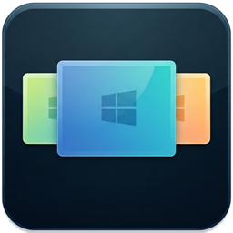

<p align="center"></p>

# OmniDesk

Switch between Windows user accounts the same way you switch virtual desktops.

Press **Ctrl+Win+Right** on your last virtual desktop and you slide over to the next signed-in account. Press **Ctrl+Win+Left** on your first desktop and you slide back. On any desktop in between, the keys do exactly what Windows already does.

> **Status:** early release for Windows 11. It relies on Windows session internals, so please open an issue if it misbehaves on your build.

## What it does

Windows already lets several accounts stay signed in at once ("Fast User Switching"), each with its own apps, windows and virtual desktops. The catch is getting between them: lock the screen, pick the other user from the corner of the sign-in screen, then wait.

OmniDesk treats your signed-in accounts as extra desktops sitting past either end of your virtual desktops:

```
 [ Account A: desk 1 | desk 2 | desk 3 ]  ->  [ Account B: desk 1 | desk 2 ]  ->  (back to A)
          Ctrl+Win+Right past the last desktop crosses into the next account
```

- Everything keeps running in the account you leave. Nothing is signed out.
- You land on the other account's **lock screen** and type its password as usual. No passwords are stored and nothing is unlocked for you.
- Accounts that aren't signed in are skipped, so the keys only ever move between live sessions.
- With a single signed-in account the extra keypress simply does nothing.

### "Land on nearest end desktop"

On by default. When you cross into an account, you arrive on that account's nearest end desktop (first desktop when you went right, last desktop when you went left), so all your accounts feel like one long row of desktops. Right-click the tray icon to turn it off; you then arrive wherever that account was last. An account that has already turned it off keeps that choice.

### Mouse buttons

Extra mouse buttons can switch desktops too. Right-click the tray icon:

- **Mouse buttons switch desktops** turns the feature on or off. It is on by default, with the Back side button going to the previous desktop and the Forward side button to the next.
- **Choose mouse buttons...** opens a window where each of five buttons (middle click, side button 1 and 2, wheel tilt left and right) can be set to *Previous desktop*, *Next desktop* or *Do nothing*. Press **Detect a button...** and then the button you mean, and the window tells you which one it is.

A mapped button switches desktop, and stops at your last or first desktop. To swap accounts from there, hold **Ctrl** while you press the button, so a stray extra click never throws you onto another account's lock screen. (The keyboard shortcut Ctrl+Win+Left/Right still swaps at the edge on its own.) While a button is mapped, other apps no longer see it, so Back and Forward stop working in browsers; turn the checkbox off to get them back. Left and right click cannot be mapped. Buttons that only exist through a mouse maker's own software are not seen by Windows as mouse buttons; map those to the keyboard shortcut in that software and OmniDesk reacts to the keys.

### Share clipboard when swapping

Off by default. Tick **Share clipboard when swapping** in the tray menu of each account that should take part. When you swap, anything you copied since you arrived in the account you are leaving (text, pictures, formatted text, copied files and folders, with no size limit) is put on the clipboard of every other account that has the box ticked, so you can swap and paste. A short notice in the tray tells you when it arrives.

- The swap never waits for the copy. A big file shows up in the other clipboard when it has finished copying.
- Copied files are copied to a private folder under `%ProgramData%\OmniDesk\clip`, because the other account usually cannot read yours. The paste uses those copies.
- Everything is dropped after **5 minutes**: an unclaimed transfer is ignored, and the folder and the file copies are deleted.
- If you swap without copying anything new, the other accounts keep their own clipboards.
- Passwords copied from a password manager are carried like anything else, so for a short time they sit in that private folder, readable only by you and the accounts that take part (and administrators).


- **Work and personal on one PC.** Keep a work profile (work email, VPN, company apps) and a personal one signed in together, and flip between them without sign-out or session loss.
- **Shared family computer.** Each person keeps their own windows and games open, and swapping between users takes one keypress instead of a trip through the lock screen.
- **Admin and standard account.** Do everyday work as a standard user and hop to a separate administrator account for the occasional elevated task.
- **Testing as different users.** Developers and IT staff checking permissions, per-user settings or first-run behaviour can cycle through test accounts quickly.
- **Client or project separation.** Freelancers can keep each client's browser sessions, files and tools in a separate account with no cross-contamination.
- **Support and troubleshooting.** Move between an affected user's account and your own while reproducing a problem, without ending either session.

## Install

1. Download `OmniDeskSetup.exe` from the [latest release](../../releases/latest).
2. Double-click it, approve the admin prompt and click **Yes**.
3. That's it. Within a few seconds the service starts OmniDesk in every account that is already signed in, and in any account that signs in later.

**Coming from "Account Swap" (v1.0.0)?** The app was renamed. Running the OmniDesk installer removes the old install first, so you don't need to uninstall it yourself. Your "Land on nearest end desktop" choice resets to the default (on).

**Update:** run the new installer again. **Uninstall:** Settings, Apps, Installed apps, OmniDesk. Silent versions: `OmniDeskSetup.exe /quiet` and `"%ProgramFiles%\OmniDesk\Uninstall.exe" /uninstall /quiet`.

Each account that should be reachable needs to be signed in already, and the hotkey only works in accounts where the app is running. It needs Windows 11 (built and developed on 11 Pro); the registry layout it reads for virtual desktops may differ on other versions.

## Build from source

Needs only the C# compiler that ships with Windows (`csc.exe`, .NET Framework 4.8). No SDK to download.

```powershell
.\build.ps1
```

This produces `bin\OmniDesk.exe` (the app) and `bin\OmniDeskSetup.exe` (the installer, with the app embedded).

## How it works

One executable, `OmniDesk.exe`, runs in two roles. A tiny installer wraps it.

```
 Account A (console)                      SYSTEM                         Account B
 +-----------------------+   named pipe   +------------------+           +---------------+
 | Agent                 | -------------> | Service          |           | Agent         |
 |  keyboard hook        |  "SWAP +1"     |  list sessions   |           |  unlock event |
 |  desktop edge check   | <------------- |  pick neighbour  |  note     |  arrival hop  |
 |  LockWorkStation      |  "OK <id>"     |  connect console | --file--> |               |
 +-----------------------+                +------------------+           +---------------+
```

### Agent (one per signed-in account, runs as that user)

- **Key capture.** A low-level keyboard hook (`WH_KEYBOARD_LL`) watches for Ctrl+Win with Left or Right. Because the hook sits in front of the shell, it can decide whether Windows should see the key at all.
- **Edge detection.** The agent decides whether you are on the first or last virtual desktop by reading `HKCU\Software\Microsoft\Windows\CurrentVersion\Explorer\VirtualDesktops`: `VirtualDesktopIDs` is a packed list of 16-byte desktop GUIDs and `CurrentVirtualDesktop` is the GUID you are on. Position in the list gives you the index. This avoids the undocumented virtual-desktop COM interfaces, which change between Windows builds.
- **Pass-through.** If you are not at the edge, the key is left alone and Windows switches desktops as normal. At the edge, the key press and its auto-repeats are swallowed and a swap is requested.
- **Start-menu guard.** Swallowing the arrow key while Win is held would make Windows open the Start menu when Win is released, so the agent injects a harmless unassigned key press (`VK 0xE8`) to cancel that. Injected input is flagged and ignored by the agent's own hook.
- **Locking behind you.** When the service accepts the request, the agent calls `LockWorkStation`, so the session you leave is never left open on the console.
- **Tray and settings.** A tray icon holds the arrival toggle, stored per account at `HKCU\Software\OmniDesk\ArrivalNearestEnd` (treated as on when the value is missing).

### Service (one per machine, runs as SYSTEM)

- **Session ring.** `WTSEnumerateSessions` plus `WTSQuerySessionInformation` produce the list of live sessions: Active or Disconnected, with a real user name, excluding session 0 (services). Sorted by session id, this is the ring. The neighbour is picked with wrap-around.
- **Console only.** The pipe client's session id (`GetNamedPipeClientSessionId`) must equal the active console session. A remote desktop session therefore cannot move the physical screen.
- **The swap.** The target session is connected to the console with `WTSConnectSession(target, console, "", false)`, the same operation as `tscon <id> /dest:console`. Doing it from SYSTEM is what allows a session to be shown without supplying its password, which is why a service is needed. If the API call fails, the service falls back to running `tscon.exe`. The call is delayed 500 ms so the agent has time to lock its own session first.
- **Rate limit.** Requests closer than 1.5 s apart are refused so a held key cannot make it bounce between accounts.
- **IPC.** A named pipe (`\\.\pipe\OmniDeskPipe`) accessible to authenticated users and SYSTEM. The protocol is one line in (`SWAP +1` or `SWAP -1`) and one line out (`OK <session>`, `NONE`, `BUSY`, `DENIED` or `ERR`).

### Arrival hand-off

Before swapping, the service writes a short note to `%ProgramData%\OmniDesk\arrival-<session>.txt` holding the direction and a UTC timestamp. When the target account's agent sees a session-unlock notification (`WTS_SESSION_UNLOCK` through `WTSRegisterSessionNotification`), it reads and deletes the note. If the note is under 60 seconds old and the account has "Land on nearest end desktop" enabled, it sends the right number of synthetic Ctrl+Win+Left/Right presses (computed from the registry desktop list) to reach the first or last desktop. Stale notes are ignored.

### Supervisor (inside the service)

Every few seconds the service checks each live session and starts an agent in any that has none. It starts the agent in that user's own session with their normal, non-elevated token (`WTSQueryUserToken` and `CreateProcessAsUser`), and only once that session has a desktop shell running. It also:

- retries no more than once every 20 seconds per session, so an agent that cannot start does not loop;
- leaves a session alone if its user chose Quit from the tray menu (the agent leaves a marker file that is cleared when the session signs out);
- stops any agent still running from an older install folder copy, so after an update every account moves to the new version within seconds without signing out.

### Mouse buttons, technically

A low-level mouse hook (`WH_MOUSE_LL`) reads the middle button, the two X buttons (side buttons, told apart by the high word of `mouseData`) and horizontal wheel movement (`WM_MOUSEHWHEEL`, the sign of the delta gives the direction). Because the hook is called for every mouse movement, it is installed only while the feature is on and at least one button is mapped (or the Detect helper is waiting), and its first act is to ignore everything except those five messages. A mapped press and its release are both swallowed, so applications never see half a click. A burst of wheel-tilt events within a quarter of a second counts as one. Events flagged as injected are ignored, so other tools' synthetic input cannot trigger it. The action runs on a worker thread through the same edge check as the keyboard shortcut: not at an edge it injects Ctrl+Win+arrow; at an edge it swaps only if Ctrl was physically down when the button was pressed (read with `GetAsyncKeyState` before the worker thread starts), and otherwise does nothing. The mappings are stored per account under `HKCU\Software\OmniDesk` as `MouseEnabled`, `MouseMiddle`, `MouseSide1`, `MouseSide2`, `MouseTiltLeft` and `MouseTiltRight`, and the hook is re-installed with the keyboard hook every minute and after each unlock.

### Clipboard sharing, technically

Each session has its own clipboard, so nothing is shared by itself. An agent whose user ticked the option writes `clip-optin-<session>.txt` (its process id) in `%ProgramData%\OmniDesk` and watches `%ProgramData%\OmniDesk\clip` with a `FileSystemWatcher`. When the service has granted a swap, the sending agent compares `GetClipboardSequenceNumber` with the value it saw at its last unlock, at start, or after the last clipboard it applied. If it is unchanged, nothing is sent. Otherwise a worker thread finds the other live sessions whose opt-in note names a running OmniDesk process in that session, turns each session's WTS user and domain into a SID, and calls `ClipTransfer.Capture`.

`Capture` walks `EnumClipboardFormats` and copies every format held in global memory: graphics handles (bitmap, metafiles, palette) and the private and GDI ranges are skipped, as are formats that only make sense inside the program that created them (OLE and shell internals such as `Shell IDList Array` and `FileContents`). Delayed-rendering formats are rendered by the owner at that moment. Registered formats are stored by name, because their numbers differ between sessions. For `CF_HDROP` each listed file or folder is copied into `files\<n>\` and the list is rewritten to point at the copies; `Preferred DropEffect` is forced to *copy* so a cut cannot try to move files out of the transfer folder. The folder is created with an ACL that drops inheritance and allows only SYSTEM, administrators, the sender and the recipients' SIDs, and the manifest is written last as `manifest.tmp` and renamed, so a receiver never sees half a transfer.

A receiving agent reads the manifest header, ignores its own sessions' transfers and anything older than five minutes, and applies the formats with `EmptyClipboard` and `SetClipboardData` (its hidden window owns the clipboard), oldest transfer first. It then records the new sequence number so what it received is not sent back, and shows a tray notice. The service sweeps `clip` every 30 seconds and deletes folders older than five minutes, and the sender also removes its own folder when the time is up.

### Keeping the key hook alive

Windows removes a low-level keyboard hook, with no error, if its callback is ever too slow. The agent keeps the callback minimal (it reads two integers and returns for every key except Left and Right), warms up the registry and marshalling code at start, runs at above-normal priority, and re-installs the hook every minute and after each unlock or console reconnect. Exceptions are caught inside the callback so a failure passes the key through instead of ending the process. The agent writes lifecycle events and errors to `%LOCALAPPDATA%\OmniDesk\agent.log` (per-key detail only with `--debug`), and the service logs to `%ProgramData%\OmniDesk\service.log`.

### Installer

`OmniDeskSetup.exe` carries `OmniDesk.exe` as an embedded resource and requests administrator rights through its manifest. It writes the files to `%ProgramFiles%\OmniDesk`, creates and starts the `OmniDeskSvc` auto-start service (restart-on-failure), adds an `HKLM\...\Run` entry so every account's agent starts at sign-in, and registers an uninstall entry for Installed apps. A copy of itself becomes `Uninstall.exe`. On an update it stops only the service, renames the running `OmniDesk.exe` aside (a running exe can be renamed but not overwritten) and writes the new one; the new service then replaces the agents that are still running the old copy.

### Security notes

- The swap only ever lands on a target's lock screen. OmniDesk never types, stores or bypasses a password.
- The service accepts requests only from the console session and acts only on existing sessions.
- If a session was left **unlocked** while disconnected (for example by closing a remote desktop connection), swapping to it shows it as it was, with no lock screen in between. Sessions this app leaves are locked first.
- Any local user can write the arrival note for a session. The worst effect is that a session's virtual desktop moves.
- Clipboard sharing moves data from one account to another on purpose. Keep it off in an account you do not want clipboard contents to leave or enter. A shared clipboard sits on disk for up to five minutes in a folder only the taking-part accounts can read.

### Known limitations

- Windows only, written against Windows 11. The virtual-desktop registry layout is undocumented and may change.
- Both ends need the agent running. The service starts and restarts it for you, except in an account where you chose Quit from the tray menu; that account stays quiet until it signs out and in.
- Accounts can only be swapped to if they are already signed in; signing in still needs the normal Windows sign-in screen.

## Project layout

```
src/Native.cs        Win32 declarations, session listing, shared helpers
src/SwapService.cs   SYSTEM service: pipe server, session ring, swap
src/Supervisor.cs    Service-side: keeps an agent running in every session
src/Agent.cs         Per-account agent: key hook, edge check, tray, arrival
src/WinApi.cs        Window enumeration and placement
src/ClipTransfer.cs  Clipboard sharing: capture, private transfer folder, apply
src/MouseSettings.cs Mouse-button mappings and the "Choose mouse buttons" window
src/Program.cs       Entry point and run modes
setup/Setup.cs       Self-contained installer and uninstaller
CONTEXT.md           Glossary of the project's terms
```

Run modes of `OmniDesk.exe`: `--agent` (default), `--debug` (agent with a log at `%LOCALAPPDATA%\OmniDesk\agent.log`), `--service`, and `--sessions` (prints the live session ring).

## License

MIT. See [LICENSE](LICENSE).
